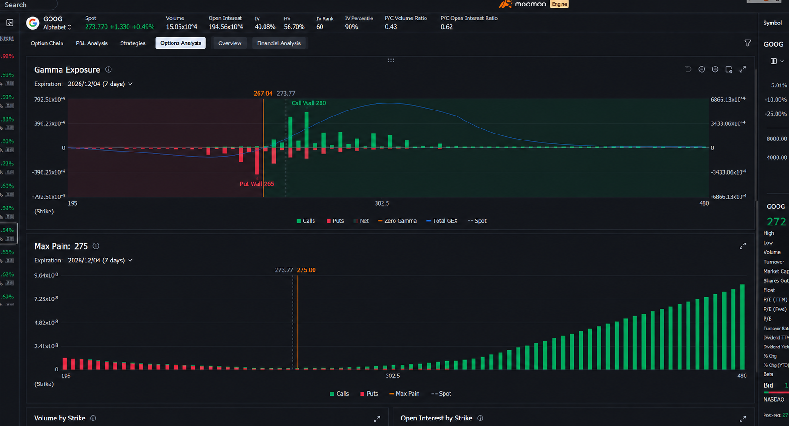
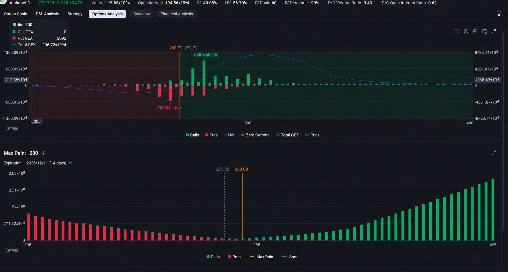
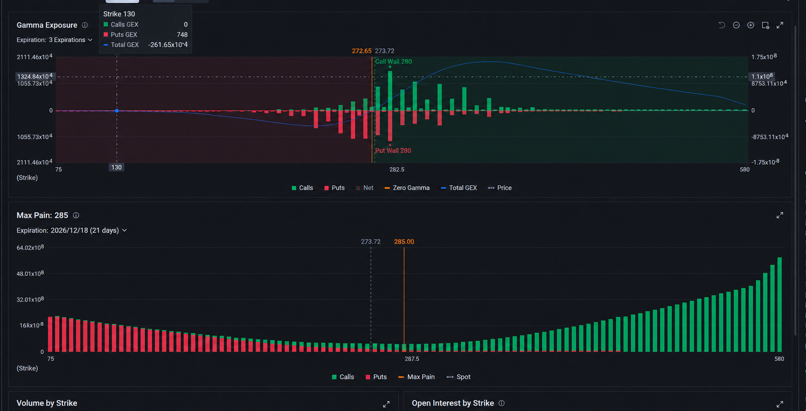
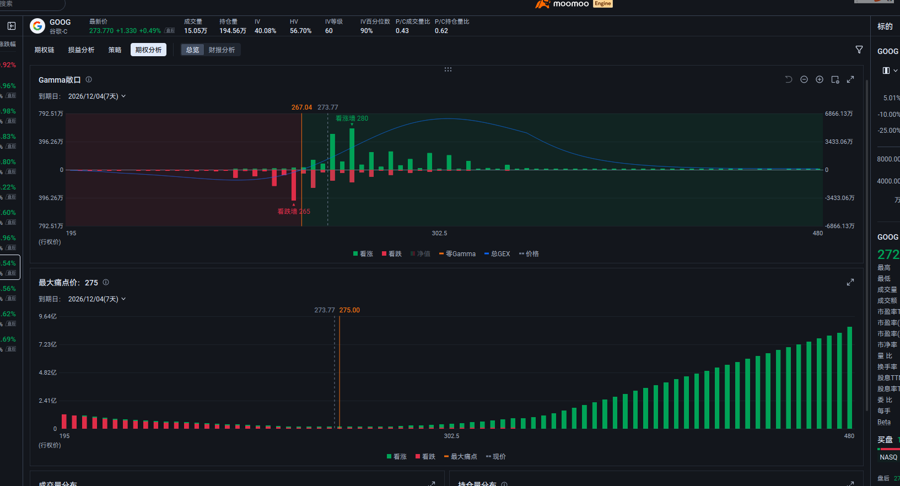
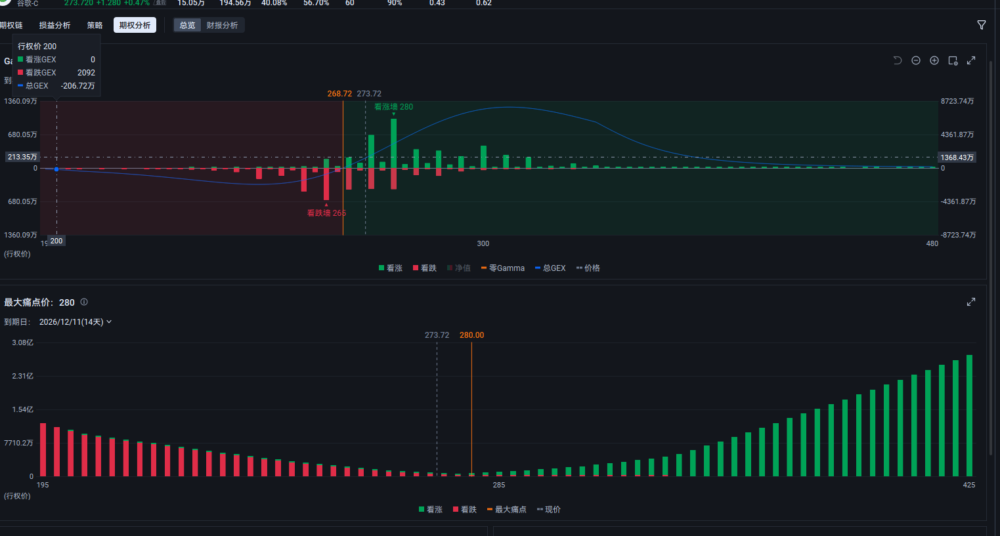
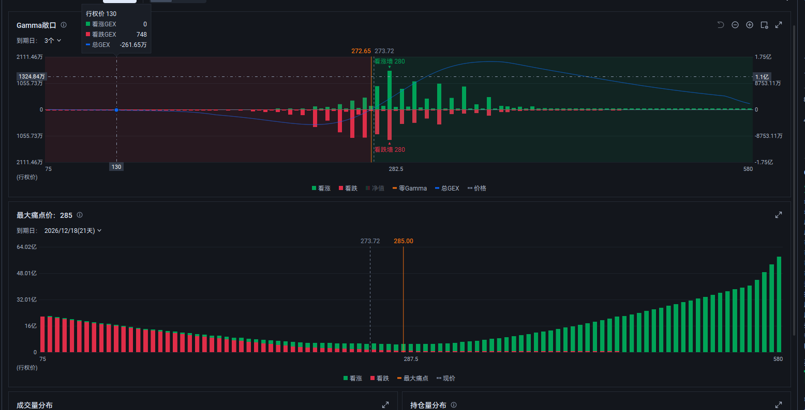

## Start the Night Before, Recheck Before the Open

On the evening of November 26, 2026, I calculated candidate levels using Gamma Exposure (GEX) and Max Pain and discussed possible trades for the next session. My QQQ 644 put trade the following morning was a zero-days-to-expiration trade: I bought it on November 27, and it expired that same day.

The distinction matters. The evening calculation gave me a plan, not permission to trade unchanged the next morning. Before the open, I still needed to check the latest available chain, prices, and relevant expirations. That is the review my process requires; the records supplied here do not establish a complete, timestamped premarket recheck.

I want to separate what I thought before trading, what I could actually observe at entry, and what became clearer afterward.

## Look Across Products, Expirations, and Time

My starting watchlist is QQQ, SPY, and DIA, the ETF tracking the Dow Jones Industrial Average. I want to know whether the pressure looks broad or concentrated in one part of the market. Within each product, I compare the nearest expiration with subsequent expirations, rather than letting one selected date define the entire picture.

I also want repeated observations: the prior evening, before the open, and when an entry becomes possible. I record which expirations a chart includes, the price at observation, and when the underlying open-interest data were effective and available. A refreshed screen does not necessarily contain newly measured open interest.

These are two independent time axes: an option's expiration date, $$T$$, and the date and time of observation, $$t$$. Comparing expirations at one moment does not replace tracking the same structure across observation times, or vice versa. After the QQQ, SPY, and DIA views support the same candidate decision, I still need to compare the actual instruments: premium, bid–ask spread, time remaining, and room left before my target. The most suitable trade must fit both the market thesis and the executable price.

My preference is to enter when the directional thesis, the observed price behavior, and the relevant options structure agree. But agreement is not a vote count. QQQ and SPY overlap, while GEX and Max Pain often use the same open-interest inputs. Several agreeing displays can still share one faulty assumption. I need to preserve disagreement and the conditions that would invalidate the trade.

## Two Calculations, Two Different Limits

A common SqueezeMetrics-style baseline assumes investors sell calls and buy puts, with dealers taking the opposite positions. That produces a call-positive, put-negative inventory proxy. It is an assumption about who holds what, not a direct reading of dealer books. [SqueezeMetrics original white paper](https://squeezemetrics.com/monitor/download/pdf/white_paper.pdf)

Long calls and long puts both have positive Gamma; short positions have negative Gamma. The contract type alone therefore does not determine the sign of a dealer's exposure. [OCC / OIC: Gamma](https://www.optionseducation.org/advancedconcepts/gamma)

For clarity, our research uses the following signed, per-1%-move dollar convention:

$$
\begin{aligned}
q_i(t)&=N_i^{D,\mathrm{long}}(t)-N_i^{D,\mathrm{short}}(t),\\
\Gamma_i(S,t)&=\frac{\partial^2 V_i(S,t)}{\partial S^2},\\
\mathrm{GEX}_{1\%}(S,t;\mathcal E)
&=0.01\,S^2\sum_{i:\,T_i\in\mathcal E}q_i(t)\,m_i\,\Gamma_i(S,t).
\end{aligned}
$$

<aside class="reflection-intuition" markdown="1">

**Intuition — how much exposure changes when price moves**

Read the sum as position size × Delta sensitivity × a 1% price move, then convert the resulting shares to dollars. In a hypothetical example, a $100 underlying, ten net-long contracts, a 100-share multiplier, and Gamma of 0.02 imply about 20 extra Delta-equivalent shares after a $1 rise: about $200 of exposure at the starting spot. Ten net-short contracts reverse the sign. With inventory, IV, and time held fixed, this is a local sensitivity estimate, not $200 of profit.

</aside>

Here $$S$$ is the underlying price in dollars per share; $$q_i$$ is dealers' net long contracts; $$m_i$$ is shares per contract; and $$V_i$$ is the long option's price quoted per share. Gamma measures the change in Delta per dollar-per-share move. The set $$\mathcal E$$ specifies the expirations included in the sum, while $$t$$ specifies the observation time. GEX in this convention is the local change in option Delta exposure for a 1% upward spot move, expressed as a dollar notional at the current spot. It is not the change in the market value of the whole position. Holding inventory, IV, and time fixed, the corresponding neutralizing hedge trades in the opposite direction:

$$
\Delta H\approx-\left(\sum_{i:\,T_i\in\mathcal E}q_i(t)\,m_i\,\Gamma_i(S,t)\right)\Delta S,
$$

<aside class="reflection-intuition" markdown="1">

**Intuition — why the hedge trades in the opposite direction**

The hedge offsets the option position's changing Delta. A net-long-Gamma dealer sells underlying as price rises and buys as it falls, leaning against the move. A net-short-Gamma dealer does the reverse, trading with the move. This describes possible feedback after a price change; it does not tell me which direction the next move will start.

</aside>

Here $$H$$ is hedge shares. Because $$q_i$$ already carries the position sign and Gamma here is for a long vanilla option, I do not add another call/put sign or an absolute value. Under the fixed-sign proxy, I replace the unobserved $$q_i$$ with:

$$
\widehat q_i(t)=s_i\,\mathrm{OI}_i(t),
\qquad
s_i=\begin{cases}+1,&\text{Call},\\-1,&\text{Put}.\end{cases}
$$

<aside class="reflection-intuition" markdown="1">

**Intuition — counting contracts is different from knowing who owns them**

Open interest counts outstanding contracts. The chosen sign assigns dealers a presumed side. Changing that assumption can change estimated GEX even when the observed contract counts stay the same. Call-positive and put-negative are the proxy's rules, not an observation of the dealer's book.

</aside>

The sign assignment comes from the SqueezeMetrics-style assumption; the factor $$0.01S^2$$ converts the local Gamma measure to the per-1%-move dollar convention used here. They are different steps, and I am not presenting this unit conversion as a verbatim formula from the white paper.

The difficult input is $$q_i$$. Open interest gives outstanding contracts, not the dealer's net side. I discuss inventory assumptions and alternative approaches in [Alpha Lab's GEX model research](https://github.com/Rexmiao/alpha-trading-lab/blob/main/docs/GEX_MODELS_RESEARCH.md). Its public calculations are research scenarios, not verified observations of the inventory behind this trade.

Max Pain is a separate calculation. For one expiration and a fixed open-interest snapshot:

$$
\begin{aligned}
L_{t,T}(x)
&=\sum_{i\in\mathcal C_T}\mathrm{OI}_i(t)\,m_i\,(x-K_i)^+\\
&\quad+\sum_{i\in\mathcal P_T}\mathrm{OI}_i(t)\,m_i\,(K_i-x)^+,\\
\mathcal M_{t,T}
&=\operatorname*{arg\,min}_{x\ge0}L_{t,T}(x),
\qquad P^*_{t,T}\in\mathcal M_{t,T}.
\end{aligned}
$$

<aside class="reflection-intuition" markdown="1">

**Intuition — try possible expiry prices and find the smallest total payout**

At each hypothetical expiry price, calculate each option's intrinsic value, multiply by its contract count and multiplier, and add everything up. Max Pain selects the price or interval with the smallest total. For example, suppose a call and a put share a $100 strike and expiration, each with fixed open interest of one contract and a 100-share multiplier. Expiry prices of $95, $100, and $105 produce total intrinsic payouts of $500, $0, and $500. The minimum is $100. This compares payouts before premiums; it does not predict that price will reach $100.

</aside>

The notation $$z^+=\max(z,0)$$ gives the positive part. The sets $$\mathcal C_T$$ and $$\mathcal P_T$$ contain calls and puts expiring on the same date $$T$$; $$\mathrm{OI}_i(t)$$ is their open interest known at observation time $$t$$; $$K_i$$ is the strike; and $$x$$ is a hypothetical expiry underlying price. The multiplier $$m_i$$ converts per-share intrinsic value to dollars per contract. Thus $$L_{t,T}$$ is measured in dollars, and $$\mathcal M_{t,T}$$ is the full set of minimizing prices, possibly a flat interval. The symbol $$P^*_{t,T}$$ denotes a selected price in that set rather than an assumed unique minimum.

It minimizes theoretical expiry intrinsic payouts. It does not include premiums or hedges, identify dealer profits, or guarantee a destination for price. Unlike signed GEX, this calculation does not first assign dealers a long or short side. See our [decision research](https://github.com/Rexmiao/alpha-trading-lab/blob/main/docs/GEX_MAXPAIN_DECISION_RESEARCH_2026-11-27.md) and [Max Pain implementation](https://github.com/Rexmiao/alpha-trading-lab/blob/main/research/max_pain.py).

Under simplified Delta hedging, dealers long Gamma trade against an existing price move; dealers short Gamma trade with it. That describes potential feedback, not whether the initial move must be up or down. The actual net position and liquidity matter. [Cboe: Gamma hedging and 0DTE market impact](https://www.cboe.com/insights/posts/volatility-insights-evaluating-the-market-impact-of-spx-0-dte-options)

## GOOG: A Company View Is Not an Entry Signal

I can be optimistic about Gemini and Google's TPU development while still finding a particular short-term entry unattractive. Those are different judgments. Options positioning adds information about the trading environment; I would not call it a replacement for business fundamentals or proof of what caused a price move.

The supplied GOOG screenshots illustrate why I need to retain scope:

| Max Pain expiration | Displayed spot | Zero Gamma | Call Wall | Max Pain |
| ------------------- | -------------: | ---------: | --------: | -------: |
| December 4, 2026    |         273.77 |     267.04 |       280 |      275 |
| December 11, 2026   |         273.72 |     268.72 |       280 |      280 |
| December 18, 2026   |         273.72 |     272.65 |       280 |      285 |

The first GEX view selects December 4. The second screenshot crops out the GEX expiration selector, so I cannot establish its scope from that image. The third GEX view combines three expirations, while its Max Pain panel selects December 18 alone. These are not three identical measurements at different dates. Capture timestamps are not recorded, so I also cannot treat these images as proof of what was visible before entry.

_Labels localized for reading; the [original Chinese screenshot](/assets/img/trading-reflections/2026-11-27/goog-2026-12-04-zh.png) is the numeric source._

_Labels localized for reading; the [original Chinese screenshot](/assets/img/trading-reflections/2026-11-27/goog-2026-12-11-zh.png) is the numeric source. The GEX expiration selector is outside the crop._

_Labels localized for reading; the [original Chinese screenshot](/assets/img/trading-reflections/2026-11-27/goog-2026-12-18-zh.png) is the numeric source. GEX combines three expirations; Max Pain uses December 18._

I was watching 280 as a potential constraint on an advance. Yet the Max Pain levels, 275, 280, and 285, are all above the displayed spot. I cannot honestly describe every panel as uniformly bearish. Nor do these images establish that GOOG cannot cross 280 or 290, or that a dealer is deliberately holding it down.

The point I want to retain is to check whether the current price, expiration structure, and entry conditions fit, even when I like the company. If price breaks above the area I treated as a constraint and holds there, I need to revise that trading view.

## What I Want to Make Repeatable

Choosing the option comes after the market thesis. I want to compare the move I expect with the premium, spread, time remaining, and loss I am prepared to accept. A cheaper put is not automatically better, and a more expensive put does not automatically require a longer holding period. An option can gain value before becoming in the money. I should evaluate its possible exit value rather than wait for that label to change.

For QQQ, my own working downside area was around 640. That is distinct from the supplied chart's Max Pain of 635 for November 27; its GEX view combines two expirations. I should keep my forecast, a vendor's calculation, and the scope of each chart separately labeled.

Next time I want a compact record of the prior-evening thesis, the data available before the open, the entry condition, the actual option quote, and the reason to cancel. If prices have already moved far toward my target, if expirations disagree, or if the result changes materially with the inventory assumption, waiting or passing is a valid outcome.

For me, the premarket review should test whether the thesis has failed. With 0DTE, time is already passing: yesterday's attractive level and today's executable quote need to be compared again.

The aim is to make the decision easier to audit, then test whether the extra information helps. This trade alone cannot validate the method. The companion note, [QQQ and SPY: reviewing the November 27 0DTE execution](/projects/trading-reflections/2026-11-27-qqq-spy-0dte-execution/), examines what happened after the plan met the market.

## 前晚做计划，开盘前仍要重看

2026 年 11 月 26 日晚上，我已经根据 Gamma Exposure（GEX）和 Max Pain 计算了一批候选点位，并讨论了次日可能做的交易。第二天买入的 QQQ 644 Put 是当日到期期权：11 月 27 日买，11 月 27 日到期，也就是 0DTE。

这个顺序很重要。前晚的计算给我的是候选计划，不能直接变成第二天不加复核的买入指令。开盘之前，我仍需要重新看当时可得的期权链、价格以及相关到期日。这里写的是流程中应该完成的复核；现有材料还不能证明我保留了一份完整、带时间戳的盘前检查记录。

我希望分清楚：哪些判断在交易之前已经有了，哪些信息是入场时能看到的，哪些理解是在复盘时才形成的。

## 同时看多个指数、期限和时间点

我通常至少想看 QQQ、SPY，以及跟踪道琼斯工业平均指数的 ETF——DIA。这样是为了区分压力来自大盘，还是主要集中在某一个板块。对每个标的，也不能只选一个到期日；最近一期和随后几期的结构可能不同。

时间上，我希望保留前晚、盘前和准备入场时的几次观察。每次记录图里包括哪些期限、当时现价多少，以及持仓量数据对应什么时点、什么时候可得。屏幕刷新了，不代表持仓量也刚刚更新。

这里有两个独立的时间轴：合约的到期日 $$T$$，以及观察数据的日期和时间 $$t$$。同一时刻比较多个到期日，不能代替在多个观察时点跟踪结构，反过来也一样。当 QQQ、SPY 和 DIA 的信息支持同一个候选决策后，还要比较实际工具的权利金、买卖价差、剩余时间以及距离目标还剩多少空间。最适合的交易，需要同时符合市场判断和真正能成交的价格。

我更愿意在方向判断、已经发生的价格行为和相关期权结构相互支持时入场。但“都指向同一边”不能机械理解成几票赞成。QQQ 和 SPY 本身就相关，GEX 和 Max Pain 又经常共用持仓量输入。多个图也可能只是重复了同一个错误假设，因此分歧和失效条件同样要留下。

## GEX 和 Max Pain，要分开理解

常见的 SqueezeMetrics 式基准，假设投资者卖 Call、买 Put，做市商承接另一边，由此形成 Call 正、Put 负的库存代理。这是在假设谁持有什么仓位，并不是直接查到了做市商的账本。[SqueezeMetrics 原始白皮书](https://squeezemetrics.com/monitor/download/pdf/white_paper.pdf)

长 Call 和长 Put 的 Gamma 都为正，空头相反。因此，不能只凭 Call 或 Put 这个名称决定做市商敞口的正负。[OCC／OIC：Gamma](https://www.optionseducation.org/advancedconcepts/gamma)

我们研究采用有符号的“标的上涨 1% 对应美元名义额”口径：

$$
\begin{aligned}
q_i(t)&=N_i^{D,\mathrm{long}}(t)-N_i^{D,\mathrm{short}}(t),\\
\Gamma_i(S,t)&=\frac{\partial^2 V_i(S,t)}{\partial S^2},\\
\mathrm{GEX}_{1\%}(S,t;\mathcal E)
&=0.01\,S^2\sum_{i:\,T_i\in\mathcal E}q_i(t)\,m_i\,\Gamma_i(S,t).
\end{aligned}
$$

<aside class="reflection-intuition" markdown="1">

**直观理解：价格动一下，敞口会变多少**

把求和想成逐笔计算持仓规模 × Delta 对价格的敏感度 × 标的上涨 1% 的幅度，再把增加的股数折成美元。举一个假设例子：标的 100 美元，净多 10 张、每张 100 股，Gamma 为 0.02。标的上涨 1 美元时，Delta 敞口局部近似增加 20 股，按起始股价折算约 200 美元；换成净空 10 张，符号反过来。这里固定库存、IV 和时间，算的是局部敏感度，不是赚了 200 美元。

</aside>

其中，$$S$$ 是标的价格，单位为美元／股；$$q_i$$ 是做市商净多头张数；$$m_i$$ 是每张合约对应股数；$$V_i$$ 是长头寸期权的每股报价。Gamma 衡量标的每变动 1 美元／股时 Delta 的变化。集合 $$\mathcal E$$ 指定合并哪些到期日，$$t$$ 指定观察时间。这里的 GEX 是标的上涨 1% 引起的期权 Delta 敞口变化，按当前股价折算的美元名义额，是局部近似，不是整个仓位市值的变化。固定库存、IV 和时间时，中性对冲需要朝相反方向调整：

$$
\Delta H\approx-\left(\sum_{i:\,T_i\in\mathcal E}q_i(t)\,m_i\,\Gamma_i(S,t)\right)\Delta S,
$$

<aside class="reflection-intuition" markdown="1">

**直观理解：对冲为什么要朝相反方向做**

对冲是把期权持仓不断变化的 Delta 抵回来。净多 Gamma 时，价格上涨就卖出一些标的，下跌就买回一些，倾向于逆着行情；净空 Gamma 时则相反，涨时买、跌时卖，倾向于顺着行情。这解释的是价格已经变化后可能产生的反馈，不能直接告诉我下一步先涨还是先跌。

</aside>

这里，$$H$$ 的单位是对冲股数。$$q_i$$ 已经包含多空符号，而这里的 Gamma 指长普通期权的 Gamma，因此不再额外乘一次 Call／Put 正负号，也不取绝对值。使用固定符号代理时，我把未观测到的 $$q_i$$ 替换为：

$$
\widehat q_i(t)=s_i\,\mathrm{OI}_i(t),
\qquad
s_i=\begin{cases}+1,&\text{Call},\\-1,&\text{Put}.\end{cases}
$$

<aside class="reflection-intuition" markdown="1">

**直观理解：数清合约，不等于看清谁持有什么**

OI 告诉我有多少未平仓合约，符号则替做市商假设一个持仓方向。即使合约数量不变，换一种方向假设，估计出的 GEX 也可能变化。Call 正、Put 负是这套代理的规则，不是已经看到了做市商账本。

</aside>

符号分配来自 SqueezeMetrics 式库存假设；$$0.01S^2$$ 则把局部 Gamma 指标换算为本文采用的每 1% 价格变动的美元口径。这是两个不同步骤，不能说白皮书逐字给出了这里的单位换算公式。

难点在 $$q_i$$。公开持仓量告诉我有多少未平仓合约，没有告诉我做市商净持有哪一边。库存假设和替代路线，整理在 [Alpha Lab 的 GEX 模型研究](https://github.com/Rexmiao/alpha-trading-lab/blob/main/docs/GEX_MODELS_RESEARCH.md)。公开计算属于研究情景，不能当成本次交易背后真实库存已被验证。

Max Pain 则是另一件事。对单一到期日、固定持仓量快照：

$$
\begin{aligned}
L_{t,T}(x)
&=\sum_{i\in\mathcal C_T}\mathrm{OI}_i(t)\,m_i\,(x-K_i)^+\\
&\quad+\sum_{i\in\mathcal P_T}\mathrm{OI}_i(t)\,m_i\,(K_i-x)^+,\\
\mathcal M_{t,T}
&=\operatorname*{arg\,min}_{x\ge0}L_{t,T}(x),
\qquad P^*_{t,T}\in\mathcal M_{t,T}.
\end{aligned}
$$

<aside class="reflection-intuition" markdown="1">

**直观理解：试几个到期价格，找出总兑付最少的位置**

先假设一个到期价格，算出每张期权的内在价值，乘上张数和合约乘数，再把所有金额加起来；换一个价格继续算，找总额最低的点或区间。举例说，同一到期日、行权价同为 100 美元的 Call 和 Put，固定 OI 各 1 张、乘数均为 100。假设到期价格为 95、100、105 美元，总内在价值分别为 500、0、500 美元，最小点就是 100。这只是未计权利金的兑付比较，不代表价格一定会走到 100。

</aside>

其中，$$z^+=\max(z,0)$$ 表示正部。$$\mathcal C_T$$ 和 $$\mathcal P_T$$ 分别是同一个到期日 $$T$$ 的 Call 与 Put 集合，$$\mathrm{OI}_i(t)$$ 是观察时点 $$t$$ 已知的持仓量，$$K_i$$ 为行权价，$$x$$ 为假设到期标的价格；乘数 $$m_i$$ 把每股内在价值换算为每张合约的美元金额。因此 $$L_{t,T}$$ 的单位是美元，$$\mathcal M_{t,T}$$ 是全部最小点组成的集合，可能是一段平坦区间。$$P^*_{t,T}$$ 表示从该集合中选出的一个价格，并不预设最小点唯一。

它求的是理论到期内在价值总额的最小点集，不包括权利金和对冲，不等于做市商实际利润最大点，也不保证价格会走过去。这个算法不需要先判断做市商站在哪一边，不能把它和 GEX 的符号问题混为一谈。方法见[交易决策研究](https://github.com/Rexmiao/alpha-trading-lab/blob/main/docs/GEX_MAXPAIN_DECISION_RESEARCH_2026-11-27.md)及 [Max Pain 计算代码](https://github.com/Rexmiao/alpha-trading-lab/blob/main/research/max_pain.py)。

在简化的 Delta 对冲下，净多 Gamma 倾向于逆着已有价格变动交易，净空 Gamma 倾向于顺着变动交易。这描述的是可能的反馈，不直接决定最初向上还是向下；真实净仓和流动性也会影响结果。[Cboe：Gamma 对冲与 0DTE 市场影响](https://www.cboe.com/insights/posts/volatility-insights-evaluating-the-market-impact-of-spx-0-dte-options)

## GOOG：看好公司，不等于这个位置值得买

我可以看好 Gemini 和 Google 的 TPU 发展，同时觉得某个短线入场位置不合适。这是两个判断。期权结构补充了交易环境的信息，不能代替公司的经营基本面，也不能仅凭一张图证明股价为什么涨跌。

几张 GOOG 截图说明了为什么需要保留统计口径：

| Max Pain 到期日 | 图示现价 | 零 Gamma | Call Wall | Max Pain |
| --------------- | -------: | -------: | --------: | -------: |
| 2026/12/04      |   273.77 |   267.04 |       280 |      275 |
| 2026/12/11      |   273.72 |   268.72 |       280 |      280 |
| 2026/12/18      |   273.72 |   272.65 |       280 |      285 |

第一张 GEX 选择的是 12 月 4 日；第二张把 GEX 的到期日选择器裁掉了，不能仅凭这张图确定其范围；第三张 GEX 合并了三个到期日，而 Max Pain 只选 12 月 18 日。不能把它们当成同一口径的三次测量。截图也没有记录抓取时间，因此不能拿它们证明入场前已经看到了哪些数值。

_原始中文截图。GEX 选择 2026/12/04；该期 Max Pain 为 275，图示现价 273.77。_

_原始中文截图。Max Pain 选择 2026/12/11，数值为 280；GEX 到期日选择器不在裁图范围内。_

_原始中文截图。GEX 合并三个到期日；Max Pain 仅选择 2026/12/18，数值为 285。_

我当时把 280 附近的集中区视为上行需要观察的一道约束。但三个 Max Pain 分别是 275、280、285，都在图示现价上方，不能硬说所有图都一致看空。这些图也不能证明 GOOG 永远过不了 280 或 290，更不能直接证明有做市商在刻意压价。

我真正想保留的思路是：即便看好公司，也要看当前位置、期限结构和入场条件是否匹配。若对上方约束的判断错了，价格有效突破并站稳，就需要更新原来的交易想法。

## 下次要把哪些步骤固定下来

方向判断之后，还要单独选工具。我想比较预期波幅与权利金、买卖价差、剩余时间，以及我愿意承担的损失，而不是只盯哪张 Put 便宜、看起来杠杆更高。权利金较低不自动等于更值得买，较贵也不自动意味着必须持有更久。期权在尚未进入价内时也可能升值，因此应比较预计退出时的价值，不必把“等它进入价内”当成唯一标准。这些问题应该在入场前想清楚，而不是持仓以后再临时补理由。

QQQ 当时在我自己的判断里，有向 640 附近靠近的可能。这里的 640 是我的目标区域；所附图中，11 月 27 日的 Max Pain 实际是 635，GEX 还合并了两个到期日。个人判断、供应商计算值和各自统计范围，应当分别标清。

下次我希望用一份简洁记录，把前晚判断、盘前可得数据、入场条件、实际期权报价和取消理由连起来。如果价格已经朝目标走了很远，如果不同期限明显冲突，或者一换库存假设结论就翻转，等待或放弃也是完整的决定。

对我来说，盘前复核不是把昨晚的观点再讲一遍，而是主动检查它有没有失效。尤其在当日到期的合约里，时间本身就在推进，昨天看起来合适的价格和今天真正能成交的价格，需要重新比较。

我想先让这个过程可复核，再检验这些信息究竟增加了多少价值。一笔交易的结果不能证明整套方法有效。另一篇[《QQQ 与 SPY：11 月 27 日 0DTE 交易执行复盘》](/projects/trading-reflections/2026-11-27-qqq-spy-0dte-execution/)，会具体看这份计划进入真实市场之后，择时和执行发生了什么。

