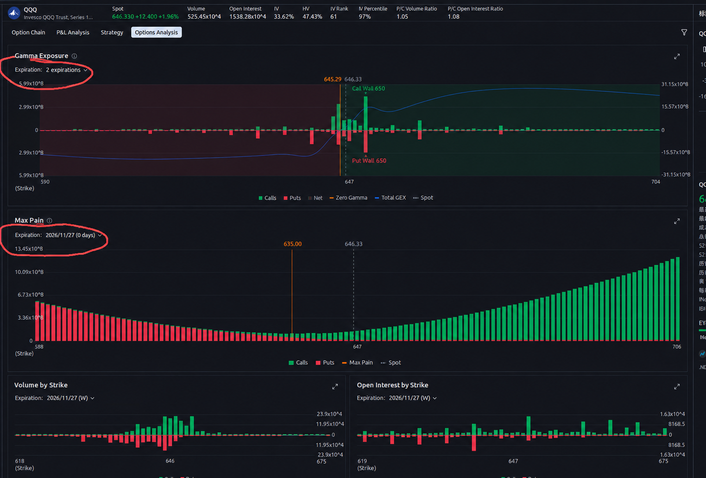
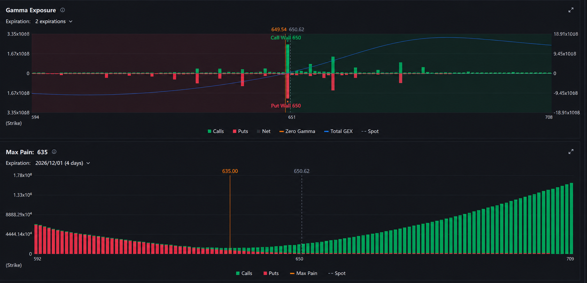
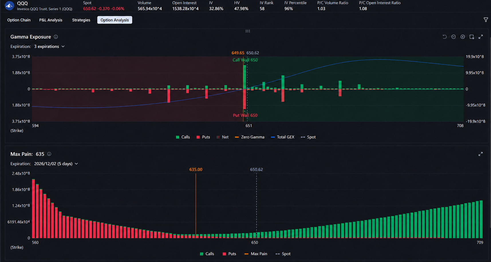
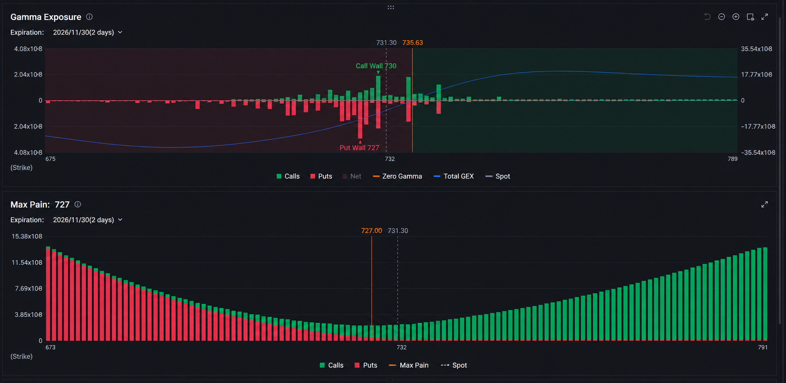
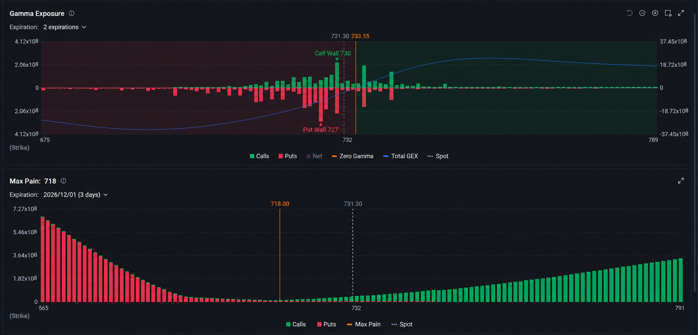
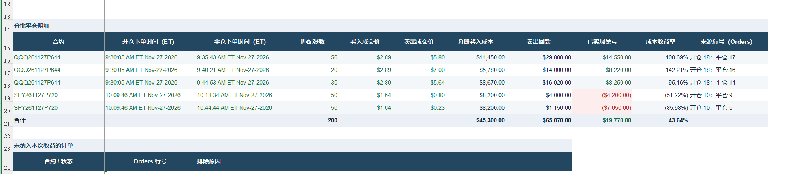
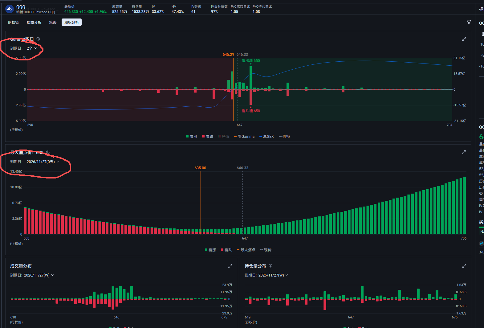
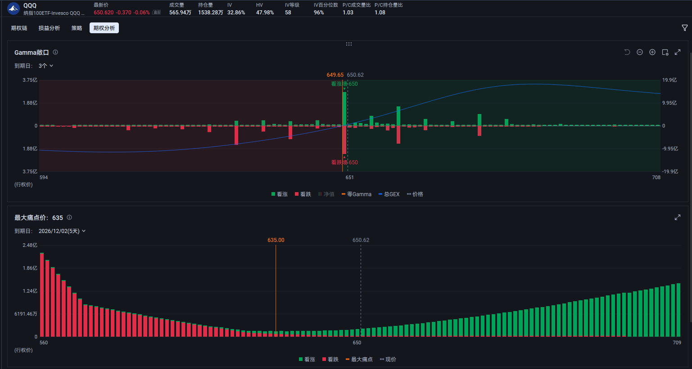
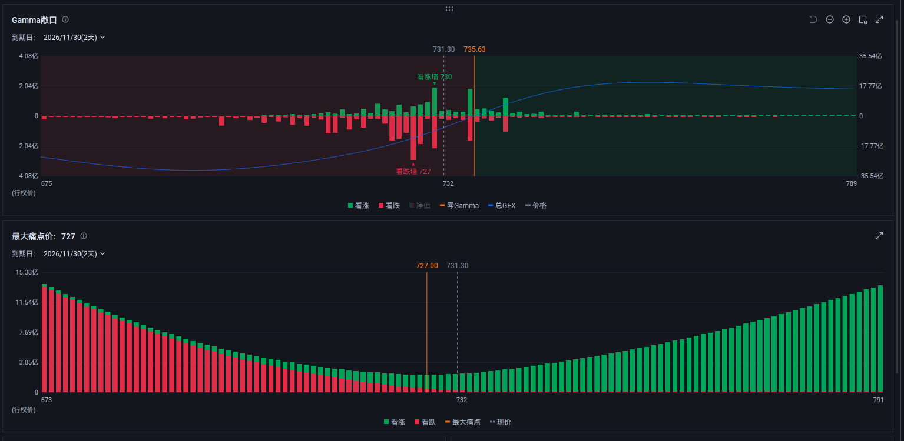
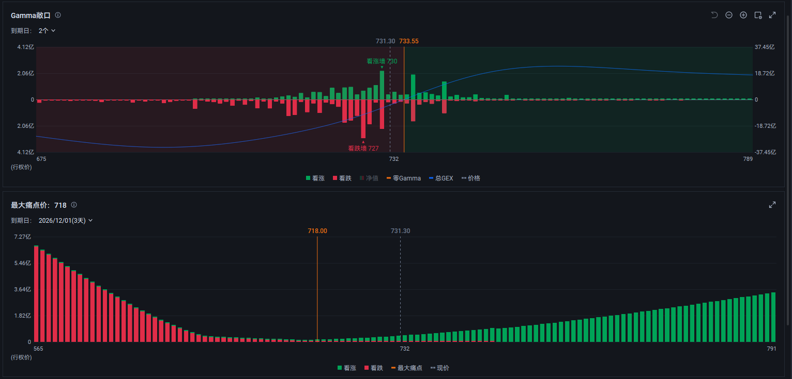

The QQQ trade on November 27 was an execution I was happy with. I entered the put position at the open and closed it in three profitable batches. Later that morning, I entered an SPY put after the decline was already underway and closed both batches at a loss. The contrast is why I want to review the timing of the two trades together.

Both positions were **0DTE options bought on November 27, 2026, and expiring that same day**. All times below are Eastern Time. The workbook provides order-submission times and average fill prices; it does not provide a timestamp for every individual execution.

## The Plan Began the Night Before

On the evening of November 26, I used my estimates of Gamma Exposure and Max Pain to prepare conditional trade candidates. For QQQ, I was watching market price near 650 and felt that sentiment was running hot. My working view was that price could move back toward the 640 area, and the 644 put was the contract I was considering for that setup. The near-650 observation is part of my recollection of the setup; it is not an exact execution price. That view was a scenario with entry conditions, rather than an unconditional instruction to buy the next morning.

The next step still needed to be a fresh check before the November 27 open: where the underlying was trading, whether the options structure had changed, which expirations each chart included, and whether the contract was still reasonably priced for the remaining opportunity. A calculation from the night before cannot settle those questions for the next morning.

_QQQ reference screenshot, with localized English labels. The Gamma chart combines two expirations; the Max Pain panel selects November 27 and shows 635. The displayed spot is 646.33, the zero-Gamma estimate is 645.29, and both wall labels are 650. My 640 scenario is distinct from the screenshot's 635 Max Pain. The screenshot has no capture timestamp establishing that 646.33 was the spot at entry. The English image is a localized illustration; the [original Chinese screenshot](/assets/img/trading-reflections/2026-11-27/qqq-gex-max-pain-zh.png) is the source._

### Compare QQQ Across Expirations and Observation Times

The two additional QQQ views below show market price at 650.62, close to the area I was watching. Their Max Pain panels select December 1 and December 2, both at 635. The corresponding GEX panels combine two and three expirations, respectively. Selecting a Max Pain expiration and choosing which expirations to aggregate in GEX are separate operations.

_QQQ: displayed spot 650.62; zero Gamma 649.54; Max Pain 635 for December 1. GEX combines two expirations. [Original Chinese screenshot](/assets/img/trading-reflections/2026-11-27/qqq-max-pain-2026-12-01-zh.png); the English version is a label-localization illustration._

_QQQ: displayed spot 650.62; zero Gamma 649.65; Max Pain 635 for December 2. GEX combines three expirations. [Original Chinese screenshot](/assets/img/trading-reflections/2026-11-27/qqq-max-pain-2026-12-02-zh.png); the English version is a label-localization illustration._

| Max Pain expiration | Displayed spot | GEX expiration scope | Zero Gamma | Max Pain |
| ------------------- | -------------: | -------------------- | ---------: | -------: |
| November 27         |         646.33 | 2 expirations        |     645.29 |      635 |
| December 1          |         650.62 | 2 expirations        |     649.54 |      635 |
| December 2          |         650.62 | 3 expirations        |     649.65 |      635 |

There are two time dimensions to track: the **expiration date of the contracts** and the **date and time when I observe their chain**. I want to compare expirations at a given observation time, then revisit those same expirations on later observations, including before the open and before entering. The screenshots do not establish a capture timeline, so the table compares views without claiming a chronological replay of the November 27 entry. December expiration levels provide context for a November 27 0DTE trade; they do not establish a same-day destination.

I discuss the assumptions behind those charts in the companion note, [How I Use GEX and Max Pain Across Indices and Expirations](/projects/trading-reflections/2026-11-27-gex-max-pain-framework/), and in the ongoing [Alpha Lab decision research](https://github.com/Rexmiao/alpha-trading-lab/blob/main/docs/GEX_MAXPAIN_DECISION_RESEARCH_2026-11-27.md).

## QQQ Execution and Partial Exits

The opening order for **100 QQQ November 27 644 puts** was submitted at **09:30:05**, with an average fill price of **$2.89**. Using the workbook's 100-share contract multiplier, the opening premium was **$28,900**.

| Closing order submitted | Contracts |          Average sale price | Allocated opening premium | Gross realized P/L | Return on premium |
| ----------------------- | --------: | --------------------------: | ------------------------: | -----------------: | ----------------: |
| 09:35:43                |        50 |                       $5.80 |                   $14,450 |           +$14,550 |          +100.69% |
| 09:40:21                |        20 |                       $7.00 |                    $5,780 |            +$8,220 |          +142.21% |
| 09:44:53                |        30 |                       $5.64 |                    $8,670 |            +$8,250 |           +95.16% |
| **QQQ total**           |   **100** | **$5.992 weighted average** |               **$28,900** |       **+$31,020** |      **+107.34%** |

The first closing order came 5 minutes and 38 seconds after the opening order, and the last came 14 minutes and 48 seconds after it. Selling in batches realized part of the gain early and reduced the number of contracts still exposed to the market. The last batch sold below the second batch's price; I did not capture a single perfect exit.

The entry timing worked well for this position. The filled orders and prices show a profitable execution, while assessing the best possible entry would require the contemporaneous underlying and option-price paths. I want to preserve the useful part of this trade: doing the preparation early enough to act when the setup appears.

## Cross-Check SPY Before Choosing the Trade

I also want to compare SPY alongside QQQ, with DIA as another broad-market reference. The goal is to see whether the directional thesis, price location, and relevant expiration structures support the same decision, then compare the remaining move, premium, spread, and loss budget to choose the most suitable entry among the candidates. Correlated indices do not turn agreement into independent confirmation.

_SPY: displayed spot 731.30; zero Gamma 735.63; Max Pain 727. Both panels select November 30. [Original Chinese screenshot](/assets/img/trading-reflections/2026-11-27/spy-max-pain-2026-11-30-zh.png); the English version is a label-localization illustration._

_SPY: displayed spot 731.30; zero Gamma 733.55; Max Pain 718 for December 1. GEX combines two expirations. [Original Chinese screenshot](/assets/img/trading-reflections/2026-11-27/spy-max-pain-2026-12-01-zh.png); the English version is a label-localization illustration._

| Max Pain expiration | Displayed spot | GEX expiration scope | Zero Gamma | Max Pain |
| ------------------- | -------------: | -------------------- | ---------: | -------: |
| November 30         |         731.30 | November 30 only     |     735.63 |      727 |
| December 1          |         731.30 | 2 expirations        |     733.55 |      718 |

These SPY views show why one selected expiration is insufficient: even at the same displayed spot, Max Pain is 727 for one expiration and 718 for another. I should record that difference and test how it affects the planned trade. The later-dated levels do not promise that a November 27 720 put will become profitable before it expires. As with QQQ, these screenshots do not establish the underlying quote at my order time.

## SPY Entered Later in the Move

The opening order for **100 SPY November 27 720 puts** was submitted at **10:09:46**, with an average fill price of **$1.64** and an opening premium of **$16,400**.

| Closing order submitted | Contracts |          Average sale price | Allocated opening premium | Gross realized P/L | Return on premium |
| ----------------------- | --------: | --------------------------: | ------------------------: | -----------------: | ----------------: |
| 10:18:34                |        50 |                       $0.80 |                    $8,200 |            −$4,200 |           −51.22% |
| 10:44:44                |        50 |                       $0.23 |                    $8,200 |            −$7,050 |           −85.98% |
| **SPY total**           |   **100** | **$0.515 weighted average** |               **$16,400** |       **−$11,250** |       **−68.60%** |

My recollection is that SPY had already fallen meaningfully by the time I entered. I had been watching and managing QQQ around the open. With limited attention and capital, I did not monitor both instruments equally well. The SPY entry therefore needs to be evaluated at 10:09, using what opportunity remained at that time.

I remember a later rebound working against the SPY puts. The workbook establishes the loss on the options; it does not isolate how much came from the underlying move, time decay, implied-volatility changes, or the spread paid in execution. For a 0DTE position, that distinction matters because the opportunity can change quickly.

The counterfactual I want to test is an earlier entry while SPY was around 730. It is plausible that an earlier expression of the same view would have had a different outcome. To put a return on that idea, I would need the option quotes, spread, and an executable exit at those earlier times. Using the day's lowest underlying price after the fact would overstate what I knew and could capture.

## Choosing the Contract and Limiting Exposure

For the QQQ trade, I wanted a contract that could respond to the expected move within the available time. The balance I had in mind involved strike, premium, sensitivity to the underlying, and the time left before expiration. A low premium alone would not make a farther out-of-the-money put attractive if the required move was unlikely to arrive in time.

A put also does not have to become in the money for a resale at a profit. Before expiration, its market price can change with the underlying, implied volatility, and remaining time. At expiration, an out-of-the-money put has no intrinsic value. Those are different tests of the trade. [OIC's long-put explanation](https://www.optionseducation.org/strategies/all-strategies/long-put)

I should also be precise when discussing leverage. Strike, premium per share, and premium per contract are separate quantities. A rough instantaneous magnitude of effective leverage for a long option is:

$$
\lambda_{\mathrm{eff}} \approx \frac{|\Delta|\,S}{P_{\mathrm{opt}}}.
$$

<aside class="reflection-intuition" markdown="1">

**Intuition — how a small underlying move is magnified in the premium**

This compares the underlying exposure that Delta gives me with the premium I pay for it. In a hypothetical example, a $100 underlying, $2 per-share put premium, and Delta of −0.5 give a magnitude of 25. A small 0.1% rise in the underlying therefore corresponds to about a 2.5% fall in the put premium under a Delta-only approximation. Gamma, IV changes, and time decay can change that result, especially for 0DTE; 25 is not account leverage or a promised return.

</aside>

Here $$S$$ is the underlying price and $$P_{\mathrm{opt}}$$ is the per-share option premium. A more expensive put does not automatically require a longer holding period, and a shorter holding period does not by itself establish lower risk. The relevant question is whether the contract fits the planned path and loss budget. I do not have same-time quotes and Greeks for the alternative strikes here, so this record cannot establish that 644 was the optimal contract.

For the next similar trade, I want to specify the premium I am willing to lose and the conditions for reducing or exiting the position before placing the order. Splitting a sale into batches helps manage the remaining position, but it still leaves the unsold contracts exposed.

## The Combined Result and the Process Change

| Position     | Opening premium | Sale proceeds | Gross realized P/L | Return on opening premium |
| ------------ | --------------: | ------------: | -----------------: | ------------------------: |
| QQQ 644 put  |         $28,900 |       $59,920 |           +$31,020 |                  +107.34% |
| SPY 720 put  |         $16,400 |        $5,150 |           −$11,250 |                   −68.60% |
| **Combined** |     **$45,300** |   **$65,070** |       **+$19,770** |               **+43.64%** |

The combined 43.64% is gross P/L divided by the sum of the opening premiums for these two positions. It excludes fees and is **not an account-level daily return**. The QQQ closing orders precede the SPY opening order; $45,300 measures cumulative premium deployed, rather than simultaneous capital at risk or starting account equity. The export is marked November 27 at 11:50:42 AM. Other trades and unfilled orders are outside this calculation.

_Original Chinese reconciliation screenshot. Contract quantities are retained. The English tables above reproduce the relevant records. The workbook's order-time fields identify submissions, not individual fill timestamps; results are gross of fees._

The change I want is a workflow that can watch QQQ, SPY, and DIA in parallel, record when a candidate first meets its conditions, and alert me when the entry is becoming stale. Each alert should include the current underlying price, the selected expiration and strike, the option quote and spread, and the reason the original scenario would be invalidated. I would review the trade before acting.

This is where quantitative tooling would help me most. Preparation can make several candidates visible at once; monitoring can preserve the timing information while my attention is on one position. A later signal should require a fresh evaluation of the remaining opportunity, rather than inheriting the conviction I had before the open.

11 月 27 日的 QQQ，是一次我比较满意的开盘执行。我在开盘时买入看跌期权，随后分三批兑现利润。同一天稍后，我买入了 SPY 的看跌期权，入场时前面的下跌已经走出一段，两批平仓都出现亏损。这两笔交易放在一起，正好让我检查方向判断怎样落实到具体的入场时机。

两笔都是 **2026 年 11 月 27 日买入、当天到期的零日期权，也就是 0DTE**。以下时间均为美国东部时间。工作簿记录的是下单时间和成交均价，没有每一笔实际撮合成交的时间戳。

## 计划从前一晚开始

11 月 26 日晚上，我已经根据自己对 Gamma Exposure 和 Max Pain 的测算，整理了次日的条件式交易候选。对 QQQ，我当时观察到市场价格接近 650，主观上感觉情绪比较热，因此考虑它可能回落、向 640 一带靠近，644 put 是针对这个情景考虑的合约。“接近 650”是我对当时机会的回忆，不代表精确的成交时点价格。这是一份带入场条件的计划，到了第二天仍需要判断条件是否成立。

11 月 27 日开盘前，还需要重新检查标的现价、期权结构有没有变化、图表各自包含哪些到期日，以及当前的合约价格是否仍然适合剩下的机会。前晚算过，只完成了准备工作；次日盘前仍应复核这些条件。

_这张 QQQ 参考图中，Gamma 敞口合并了 2 个到期日，Max Pain 则单独选择 11 月 27 日，数值为 635；图示现价为 646.33，零 Gamma 估计点为 645.29，Call Wall 和 Put Wall 都标为 650。我所说的“向 640 靠近”是自己的情景目标，与图上的 635 Max Pain 分开记录。截图没有可确认的采集时间，不能把 646.33 当作实际入场时的标的价格。_

### 比较 QQQ 的不同到期日，并在不同观察时间复核

下面补充的两张 QQQ 图，现价都显示为 650.62，接近我当时关注的区域。Max Pain 分别选择 12 月 1 日和 12 月 2 日，数值都为 635；对应的 GEX 则分别合并两个和三个到期日。选择某一期 Max Pain，与决定 GEX 合并哪些期限，是两个需要分别记录的操作。

_QQQ 原始截图：图示现价 650.62，零 Gamma 649.54；Max Pain 选择 2026/12/01，数值为 635。GEX 合并两个到期日。_

_QQQ 原始截图：图示现价 650.62，零 Gamma 649.65；Max Pain 选择 2026/12/02，数值为 635。GEX 合并三个到期日。_

| Max Pain 到期日 | 图示现价 | GEX 到期日范围 | 零 Gamma | Max Pain |
| --------------- | -------: | -------------- | -------: | -------: |
| 11 月 27 日     |   646.33 | 合并 2 期      |   645.29 |      635 |
| 12 月 1 日      |   650.62 | 合并 2 期      |   649.54 |      635 |
| 12 月 2 日      |   650.62 | 合并 3 期      |   649.65 |      635 |

这里有两条时间轴：一条是**合约的到期日**，另一条是**我观察期权链的日期与时间**。我希望在同一个观察时点比较不同到期日，再在之后的观察中重新检查同一批期限，尤其是盘前和准备入场时。截图没有可核验的采集时间线，因此这张表用来对照结构，不把它当成 11 月 27 日入场过程的逐时回放。12 月到期的点位可以提供背景，但不能证明 11 月 27 日的零日期权就会在当天等到那个价格。

这些指标的估计假设，另见配套笔记[我如何结合多指数和多到期日使用 GEX 与 Max Pain](/projects/trading-reflections/2026-11-27-gex-max-pain-framework/)，以及持续推进中的 [Alpha Lab 交易决策研究](https://github.com/Rexmiao/alpha-trading-lab/blob/main/docs/GEX_MAXPAIN_DECISION_RESEARCH_2026-11-27.md)。

## QQQ 的开盘执行与分批平仓

**100 张 QQQ 11 月 27 日到期、行权价 644 的 put**，开仓订单于 **09:30:05** 提交，成交均价为 **2.89 美元**。按工作簿使用的每张 100 股合约乘数计算，开仓权利金共 **28,900 美元**。

| 平仓下单时间 |    张数 |            卖出均价 | 分摊开仓权利金 | 已实现毛盈亏 | 权利金收益率 |
| ------------ | ------: | ------------------: | -------------: | -----------: | -----------: |
| 09:35:43     |      50 |               $5.80 |        $14,450 |     +$14,550 |     +100.69% |
| 09:40:21     |      20 |               $7.00 |         $5,780 |      +$8,220 |     +142.21% |
| 09:44:53     |      30 |               $5.64 |         $8,670 |      +$8,250 |      +95.16% |
| **QQQ 合计** | **100** | **加权均价 $5.992** |    **$28,900** | **+$31,020** | **+107.34%** |

第一笔平仓订单距开仓订单 5 分 38 秒，最后一笔相隔 14 分 48 秒。分批卖出让我较早兑现一部分利润，也减少了继续留在市场里的合约数量。最后一批的卖价低于第二批，我没有卖在同一个最优位置。

对这笔持仓来说，这次入场时机是有效的。订单和价格能够证明这次执行获得了盈利；要判断是否存在更好的入场点，还需要当时标的与期权价格的完整路径。我想保留的是这次流程里做对的部分：提前准备，使自己能够在条件出现时及时执行。

## 同时对照 SPY，再选择更合适的交易

我也希望把 SPY 和 QQQ 放在一起观察，并用 DIA 补充大盘视角。目标是让方向判断、现价位置和相关到期日的结构共同支持一个决策，再比较各候选还剩下多少空间、权利金、价差和损失预算，选出更适合执行的入场机会。指数之间的相关性仍然存在，不能把一致意见当成几份独立验证。

_SPY 原始截图：图示现价 731.30，零 Gamma 735.63；GEX 和 Max Pain 都选择 2026/11/30，Max Pain 为 727。_

_SPY 原始截图：图示现价 731.30，零 Gamma 733.55；Max Pain 选择 2026/12/01，数值为 718。GEX 合并两个到期日。_

| Max Pain 到期日 | 图示现价 | GEX 到期日范围 | 零 Gamma | Max Pain |
| --------------- | -------: | -------------- | -------: | -------: |
| 11 月 30 日     |   731.30 | 仅 11 月 30 日 |   735.63 |      727 |
| 12 月 1 日      |   731.30 | 合并 2 期      |   733.55 |      718 |

这组 SPY 图说明了为什么不能只选一个到期日：同样显示 731.30 的现价，两个期限的 Max Pain 却分别是 727 和 718。我需要记录这种差异，检查它对原交易计划有什么影响。较远期限的参考点，并不保证 11 月 27 日到期的 720 put 能在到期前获利；这些截图也没有证明下单时的标的现价。

## SPY 入场时机会已经变化

**100 张 SPY 11 月 27 日到期、行权价 720 的 put**，开仓订单于 **10:09:46** 提交，成交均价为 **1.64 美元**，开仓权利金共 **16,400 美元**。

| 平仓下单时间 |    张数 |            卖出均价 | 分摊开仓权利金 | 已实现毛盈亏 | 权利金收益率 |
| ------------ | ------: | ------------------: | -------------: | -----------: | -----------: |
| 10:18:34     |      50 |               $0.80 |         $8,200 |      −$4,200 |      −51.22% |
| 10:44:44     |      50 |               $0.23 |         $8,200 |      −$7,050 |      −85.98% |
| **SPY 合计** | **100** | **加权均价 $0.515** |    **$16,400** | **−$11,250** |  **−68.60%** |

按我的回忆，买入 SPY 时，价格已经明显跌下来一段。开盘时我的注意力主要放在 QQQ 上，需要观察并管理那笔持仓。资金和注意力有限，我没有同样及时地盯住两个标的。因此，这笔 SPY 必须放回 10:09 当时的条件里，重新评估还剩下多少空间。

我记得后面的反弹对 SPY put 不利。工作簿能够确认期权上的亏损，但不能单独拆出标的反弹、时间损耗、隐含波动率变化和买卖价差各自贡献了多少。对当天到期的持仓，这种区分很重要，因为机会变化得很快。

我想检验的一个反事实是：如果在 SPY 约 730 时，就已经关注并执行这笔交易，结果会怎样？提前表达同一个方向，可能得到不同的结果。但要给出具体收益，还需要那个时点的期权报价、价差和可执行的离场条件。直接拿当天最低的标的价格来倒算，会高估当时已经知道、也能够抓住的机会。

## 合约选择与风险暴露

选择 QQQ 这张 put 时，我想要的是合约能在剩余时间里，对预期中的行情作出足够的反应。这里需要一起权衡行权价、权利金、对标的变动的敏感度，以及离到期还有多久。更虚值的 put 即使便宜，如果所需的价格移动无法及时出现，也未必适合这笔交易。

Put 在到期前转手获利，并不要求它一定先进入实值。到期前，它的市场价格会随标的、隐含波动率和剩余时间变化；到了到期时，虚值 put 则没有内在价值。这是两种不同的判断。[OIC 对买入看跌期权的说明](https://www.optionseducation.org/strategies/all-strategies/long-put)

讨论杠杆时，我也需要把行权价、每股权利金和每张合约成本分开。买入期权的瞬时有效杠杆大小，可以粗略写成：

$$
\lambda_{\mathrm{eff}} \approx \frac{|\Delta|\,S}{P_{\mathrm{opt}}}.
$$

<aside class="reflection-intuition" markdown="1">

**直观理解：标的小幅变化，会把权利金放大多少**

这个比值是在比较Delta 带来的标的敞口和为此支付的权利金。举一个假设例子：标的 100 美元，Put 每股价格 2 美元，Delta 为 −0.5，算出的大小就是 25。标的小幅上涨 0.1%，只看 Delta 的一阶近似，Put 权利金约下跌 2.5%。Gamma、IV 变化和时间损耗都会改变实际结果，尤其是零日期权；这里的 25 不是账户杠杆，也不是收益承诺。

</aside>

其中 $$S$$ 是标的价格，$$P_{\mathrm{opt}}$$ 是每股期权价格。权利金较高，不自动意味着必须拿更久；拿得更短，也不自动证明风险更低。关键是合约是否适合计划中的价格路径和损失预算。这里没有其他行权价在同一时刻的报价与 Greeks，所以不能由这份记录证明 644 一定是最优选择。

下一次遇到类似交易，我希望在下单前写清楚愿意损失多少权利金，以及什么条件下减仓或退出。分批卖出可以管理剩余持仓，但未卖出的合约仍继续承担风险。

## 合并结果与下一步改进

| 持仓        |  开仓权利金 |    卖出回款 | 已实现毛盈亏 | 开仓权利金收益率 |
| ----------- | ----------: | ----------: | -----------: | ---------------: |
| QQQ 644 put |     $28,900 |     $59,920 |     +$31,020 |         +107.34% |
| SPY 720 put |     $16,400 |      $5,150 |     −$11,250 |          −68.60% |
| **合计**    | **$45,300** | **$65,070** | **+$19,770** |      **+43.64%** |

这里的 43.64%，是这两笔已实现毛盈亏除以两笔累计开仓权利金，未扣费用，**不是账户当日收益率**。从订单顺序看，QQQ 的平仓下单早于 SPY 的开仓下单；45,300 美元是两笔交易累计投入的权利金，不能据此推断同时在险资金或账户起始资产。导出页脚标注的时间为 11 月 27 日上午 11:50:42，其他交易与未成交订单不在这个计算范围内。

_原始交易汇总截图，按本次写作要求保留具体张数。上表重列了相关数据；时间为下单时间，盈亏为未扣费用的毛结果。_

我希望下一步的工具能同时观察 QQQ、SPY 和 DIA，记录候选机会第一次满足条件的时间，并在入场已经变晚时提醒我。提醒需要带上当前标的价格、所选到期日与行权价、期权报价和价差，以及原情景在什么条件下失效，再由我审阅后决定是否交易。

量化工具在这里最有价值的地方，是让我能够同时看见多个候选，并在注意力放在一笔持仓上时，保留其他机会的时间信息。稍后再出现的信号，需要重新计算它还剩下多少空间，才能决定是否仍值得执行。

